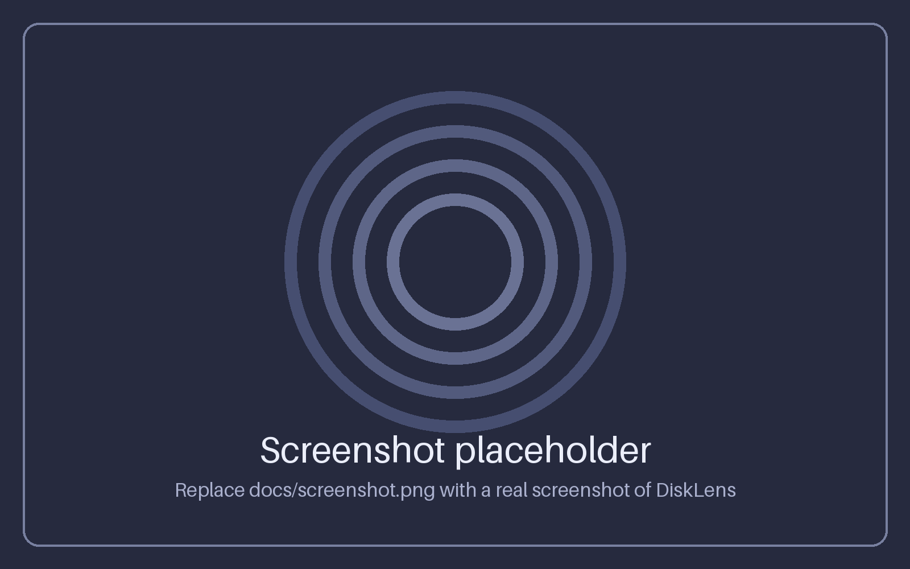
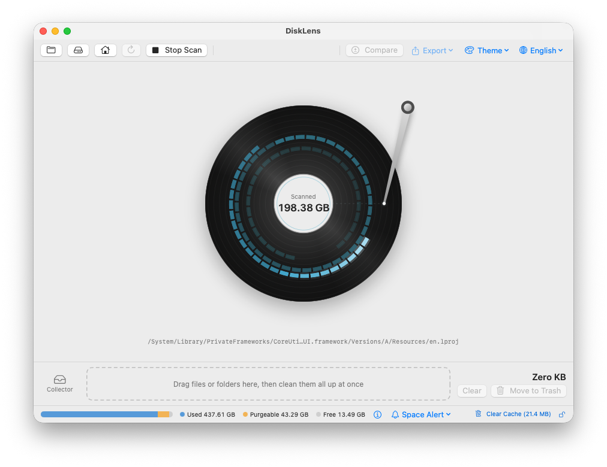
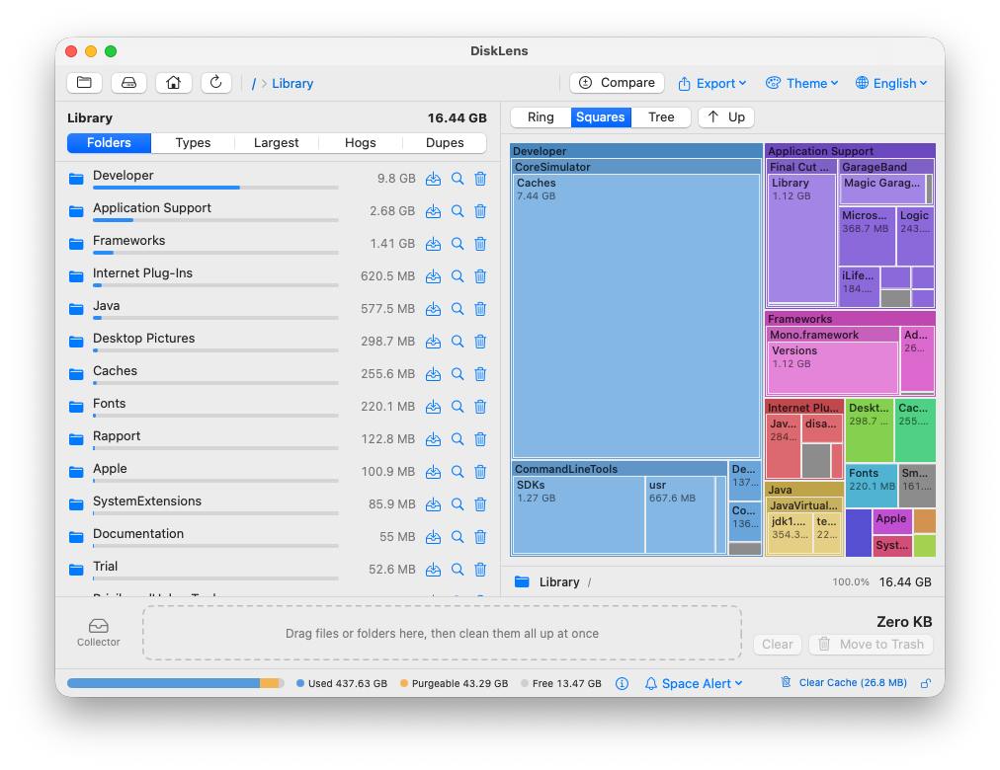

# DiskLens

**English** | [中文](#中文)

A native macOS disk-usage analyzer built with SwiftUI. See at a glance what is eating your disk, drill into folders on an interactive sunburst chart, and clean up in one go.



| Scanning | Squares view |
|:---:|:---:|
|  |  |

## Features

- **Sunburst chart** – up to 4 rings, click a slice to drill in, click the center to go back up, hover to see name and size. Breadcrumbs for quick navigation.
- **Three display styles** – switch the right-hand view between the *Ring* chart, a *Squares* treemap (nested squarified rectangles; click to drill in, *Up* to go back) and an expandable *Tree* list with size bars and percentages. Your choice is remembered.
- **Fast scanning** – directories are scanned in parallel on all CPU cores at every level and read in batches (`getattrlistbulk`); in our tests a full-disk scan of about 420 GB of used space took roughly 15 seconds on an Apple Silicon Mac. Small items (< 2 MB) are merged into a single node to keep memory low.
- **Scan animation** – a spinning disk platter whose read head seeks across the tracks and lights up the sectors it reads, with the running byte count and the directory currently being scanned; the chart sweeps open when the scan finishes. Stop the scan from the toolbar.
- **Collector** – drag slices or list rows into the collector tray at the bottom, review the total size, then move everything to the Trash at once. Nested selections are merged automatically so nothing is counted twice.
- **File type breakdown** – switch the side panel to *File Types* to see video, audio, images, documents, archives/installers/disk images, apps, code and other, with a stacked overview bar. Click a type to list its largest files.
- **Color by type** – in *File Types* mode the chart is colored by dominant file type; pick a type in the legend to highlight where it lives and fade out everything else.
- **Purgeable space** – the bottom bar splits the startup volume into *used*, *purgeable* and *free*, so you can tell what macOS can reclaim by itself.
- **Menu bar icon** – shows your available space and turns into a warning when the disk is nearly full; a capacity panel, launch at login, and quick access to the window. Closing the window only hides it, so monitoring and notifications keep running; quit with ⌘Q or from the menu bar panel. When launched at login it starts quietly in the menu bar without opening a window (configurable). Optional *menu bar only* mode hides the Dock icon while the window is closed.
- **Low disk space alert** – checks the disk's available space (free + purgeable) every minute and shows a banner when it drops below your limit (below 10 / 20 / 50 / 100 GB or 10 / 15 / 20%). The packaged app can also send a system notification while it is in the background.
- **Compare scans** – every complete scan is kept as a snapshot (latest 8 per folder). Compare the current scan with an earlier one to see what grew or shrank: total change, a drill-down folder hierarchy, and a list of new / grown / shrunk / removed files. When a scan finishes, a banner tells you how much the total changed since the last one.
- **Usage by extension** – inside the *Types* tab, switch to *By extension* to rank every extension (`.mp4`, `.dmg`, `.swift`…) by size, filter them, and click one to see its largest files — the sunburst lights up where that extension lives. At the scan root the numbers are exact and include every small file.
- **Export reports** – export a Markdown report (capacity, file-type breakdown, largest folders and files, space hogs, duplicates, collector) or a CSV list of every scanned file ≥ 2 MB. Reports follow the UI language and show your home folder as `~`.
- **Largest files** – a leaderboard of the biggest files in the folder you are viewing (Top 50 / 100 / 200, filterable by file type). Filter to files you haven't modified for 3 months, 6 months, 1 year or 2 years to find big files you no longer use, or sort oldest-first. Every row has Collector, reveal and Trash actions.
- **Space hogs** – a dedicated tab that measures well-known space eaters (Xcode DerivedData / device support / archives, Homebrew, npm, Yarn, pnpm, CocoaPods, Gradle, pip, Cargo, Docker, iOS backups, caches, logs, Trash…), tells you which are safe to clean, shows the recommended cleanup command where one exists, and can add all the safe ones to the Collector in one click.
- **Duplicate finder** – finds identical files in the folder you are viewing (size → quick hash → full SHA-256, all CPU cores). Review each group, keep one copy, and send the rest to the Collector; at least one copy per group always stays. Hard links, app bundles, `.git`, `node_modules` and `~/Library` are skipped.
- **Stop scan** – cancel a running scan at any time; what was scanned so far is shown but flagged as incomplete and is never saved.
- **Saved scan results** – each scan is saved to `~/Library/Application Support/DiskLens/`, and the app reopens instantly with the last result (with a banner showing when it was scanned and a *Rescan* button). Items you move to the Trash are removed from the saved result too.
- **English / 中文** – switch the interface language from the toolbar (🌐); your choice is remembered, and the default follows the system language.
- **Color themes inspired by Apple Books** – *Original* (follows the system), *Paper*, *Calm*, *Quiet* and *Night*. Backgrounds, accent color and chart colors all adapt; pick one from the palette menu in the toolbar.
- **Safe deletion** – items are moved to the Trash (never permanently deleted) after a confirmation, so they can be restored.
- **Private** – everything runs locally. No network access, no telemetry.

## Requirements

- macOS 13 (Ventura) or later
- Xcode or the Command Line Tools (`xcode-select --install`) with Swift 5.9+

## Build & Run

```bash
git clone https://github.com/Exposer/DiskLens.git
cd DiskLens
```

Run directly:

```bash
swift run -c release
```

Or build a double-clickable app bundle (with icon, ad-hoc signed):

```bash
./make_app.sh
```

This produces `DiskLens.app`; drag it into `/Applications`. You can also open `Package.swift` in Xcode and press ⌘R.

> **Gatekeeper:** the app is only ad-hoc signed. If macOS blocks it, right-click the app and choose *Open*.

## Permissions

To scan protected locations such as `~/Library`, grant **Full Disk Access** in *System Settings → Privacy & Security → Full Disk Access* (a shortcut button is in the app's status bar). Without it, some folders are skipped and totals will be lower.

## Notes

- Sizes are allocated sizes on disk, so they may differ slightly from Finder's "logical" sizes.
- Purgeable content (caches, local snapshots, re-downloadable iCloud files) is not visible to a file scan, so scanned totals can be lower than the "used" figure.
- Symbolic links are skipped. When scanning `/`, `/Volumes` and `/System/Volumes` are skipped to avoid counting the same data twice.

## Project layout

```
Sources/DiskLens/
├── App.swift          App entry point
├── Model.swift        Scanner, data model, sunburst layout, view model
├── Views.swift        Main window, file list, collector, sunburst view
├── ChartViews.swift   Display styles (ring / squares treemap / tree list), disk-read scan animation
├── Categories.swift   File type classification, type coloring, legend
├── MenuBar.swift      Menu bar icon, hide-on-close, launch at login
├── LowSpace.swift     Low disk space alert
├── Diff.swift         Compare scans
├── Extensions.swift   Usage by file extension
├── Report.swift       Markdown / CSV report export
├── BigFiles.swift     Largest files leaderboard
├── Hogs.swift         Space Hogs tab
├── Duplicates.swift   Duplicate file finder
├── Persistence.swift  Saved scan results
├── Settings.swift     Language, themes, preferences
└── Capacity.swift     Used / purgeable / free volume bar
Resources/AppIcon.png  1024×1024 app icon source
make_app.sh            Builds DiskLens.app
```

## License

[MIT](LICENSE)

---

<a id="中文"></a>

# DiskLens(中文)

[English](#disklens) | **中文**

一款用 SwiftUI 编写的原生 macOS 磁盘空间分析工具。一眼看出是什么占满了你的磁盘,在交互式环形图里逐层深入,再一次性清理。


| 扫描中 | 方块图 |
|:---:|:---:|
|  |  |

## 功能

- **环形图(Sunburst)**:最多 4 圈。点击扇形进入该目录,点击中心返回上一级,悬停显示名称和大小,顶部有面包屑导航。
- **三种显示方式**:右侧视图可在「环形图」、「方块图」(矩形树图,嵌套的方块,点击进入、「上一级」返回)和可展开的「树形列表」(带大小条和百分比)之间切换,并记住你的选择。
- **快速扫描**:每一层目录都在所有 CPU 核心上并行扫描,并用 `getattrlistbulk` 批量读取目录;在我们的测试里,约 420 GB 已用空间的整盘扫描在 Apple Silicon Mac 上大约用了 15 秒。小于 2 MB 的项目合并成一个节点,节省内存。
- **扫描动画**:扫描时显示一张旋转的盘片,磁头在磁道间寻道并点亮读到的扇区,同时显示已统计的大小和当前正在扫描的目录;扫描完成后环形图会顺时针展开。停止扫描请用工具栏里的按钮。
- **收集器**:把环形图扇形或列表行拖到底部的收集器里,查看总大小,然后一次性移到废纸篓。重叠的选择会自动合并,不会重复计算。
- **按文件类型汇总**:把侧边栏切到「文件类型」,可以看到视频、音频、图片、文档、压缩包/安装包/磁盘映像、应用程序、代码和其他的占比,并带一条堆叠总览条。点某个类型,列出该类型里最大的文件。
- **按类型着色**:在「文件类型」模式下,环形图按主要文件类型着色;在图例里选一个类型,就能高亮它分布在哪里,其余部分变淡。
- **可清除空间**:底部容量条把启动磁盘分成「已用」「可清除」「空闲」三段,让你知道哪些空间 macOS 会自动回收。
- **菜单栏图标**:显示可用空间,磁盘快满时变成警告图标;有容量面板、开机自动启动和打开窗口的入口。关闭窗口只是隐藏,监控和通知继续工作;用 ⌘Q 或菜单栏面板退出。开机自动启动时只在菜单栏里安静待着、不弹窗口(可在面板里改)。还可选「仅在菜单栏显示」模式:窗口关闭时隐藏 Dock 图标。
- **磁盘快满时提醒**:每分钟检查一次磁盘的可用空间(空闲 + 可清除),低于设定值(不足 10 / 20 / 50 / 100 GB 或 10% / 15% / 20%)时显示提示条;打包后的 App 在后台时还能发系统通知。
- **对比扫描**:每次完整扫描都会保存一份快照(每个文件夹保留最近 8 份)。把当前扫描和之前的某次对比,看什么变大了、什么变小了:总大小变化、可逐层点进去的文件夹层级、新增 / 增长 / 减少 / 已删除的文件列表。每次扫描完成后,顶部还会提示总大小比上次多了或少了多少。
- **按扩展名统计**:在「文件类型」页切到「按扩展名」,按大小排列所有扩展名(`.mp4`、`.dmg`、`.swift` 等),可筛选,点一个就能看它最大的文件,环形图会高亮它分布在哪里。在扫描根目录上数字是精确的,包含所有小文件。
- **导出报告**:可导出 Markdown 报告(容量、文件类型汇总、最大的文件夹和文件、占用大户、重复文件、收集器),或所有 2 MB 以上文件的 CSV 清单。报告语言跟随界面,个人文件夹显示为 `~`。
- **大文件排行榜**:当前文件夹里最大的文件排行(前 50 / 100 / 200 个,可按文件类型筛选)。可筛选「超过 3 个月 / 6 个月 / 1 年 / 2 年没修改」的文件,找出不再使用的大文件,也可以按最久未修改排序。每一行都能加入收集器、在 Finder 中显示或移到废纸篓。
- **占用大户**:专门的一页,统计 Xcode(DerivedData / 设备支持 / 归档)、Homebrew、npm、Yarn、pnpm、CocoaPods、Gradle、pip、Cargo、Docker、iOS 备份、缓存、日志、废纸篓等常见占空间的位置,标明哪些可以放心清理,有推荐命令的会一并给出,还能一键把所有「可清理」项加入收集器。
- **重复文件查找**:在当前查看的文件夹里查找内容完全相同的文件(先比大小,再快速哈希,最后完整 SHA-256,多核并行)。逐组查看,保留一份,其余送进收集器;每组始终至少保留一份。硬链接、应用包、`.git`、`node_modules` 和 `~/Library` 不在查找范围内。
- **停止扫描**:扫描过程中随时可以停止,已扫到的部分会显示出来,但会标明结果不完整,也不会保存。
- **保存扫描结果**:每次扫描后的结果会保存到 `~/Library/Application Support/DiskLens/`,下次打开 App 直接载入上次的结果,顶部有横幅提示扫描时间和「重新扫描」按钮。移到废纸篓的项目也会同步从已保存的结果里去掉。
- **中英文切换**:在工具栏的 🌐 菜单里切换界面语言,选择会被记住,默认跟随系统语言。
- **参考 Apple Books 的配色方案**:「原始」(跟随系统)、「纸张」、「柔和」、「安静」、「夜间」。背景、强调色和图表颜色都会随之变化,在工具栏的调色板菜单里选择。
- **安全删除**:确认后只会移到废纸篓,不会永久删除,可以随时恢复。
- **隐私**:全部在本地运行,不联网,没有任何数据上报。

## 系统要求

- macOS 13(Ventura)或更高版本
- Xcode 或命令行工具(`xcode-select --install`),Swift 5.9+

## 编译与运行

```bash
git clone https://github.com/Exposer/DiskLens.git
cd DiskLens
```

直接运行:

```bash
swift run -c release
```

或者打包成可双击的 App(带图标,自签名):

```bash
./make_app.sh
```

会生成 `DiskLens.app`,把它拖进「应用程序」即可。也可以用 Xcode 打开 `Package.swift`,然后按 ⌘R。

> **Gatekeeper**:App 只做了本地自签名。如果被 macOS 拦截,右键点击 App 选择「打开」。

## 权限

要扫描 `~/Library` 等受保护的位置,请在「系统设置 → 隐私与安全性 → 完全磁盘访问权限」中授权(App 状态栏里有直达按钮)。没有授权的话,部分文件夹会被跳过,统计结果会偏小。

## 说明

- 统计的是文件在磁盘上实际占用的空间,和访达显示的「逻辑大小」可能略有差异。
- 可清除内容(缓存、本地快照、可重新下载的 iCloud 文件)文件扫描看不到,所以扫描总和可能小于「已用」。
- 符号链接会被跳过。扫描 `/` 时会跳过 `/Volumes` 和 `/System/Volumes`,避免同一份数据被重复统计。

## 项目结构

```
Sources/DiskLens/
├── App.swift          应用入口
├── Model.swift        扫描器、数据模型、环形图布局、ViewModel
├── Views.swift        主窗口、文件列表、收集器、环形图
├── Categories.swift   文件类型分类、按类型着色、图例
├── MenuBar.swift      菜单栏图标、关窗口不退出、开机启动
├── LowSpace.swift     磁盘快满提醒
├── Diff.swift         对比扫描
├── Extensions.swift   按扩展名统计
├── Report.swift       Markdown / CSV 报告导出
├── BigFiles.swift     大文件排行榜
├── Hogs.swift         占用大户
├── Duplicates.swift   重复文件查找
├── Persistence.swift  保存扫描结果
├── Settings.swift     语言、配色、偏好设置
└── Capacity.swift     已用 / 可清除 / 空闲 容量条
Resources/AppIcon.png  1024×1024 应用图标源文件
make_app.sh            打包 DiskLens.app
```

## 许可证

[MIT](LICENSE)
